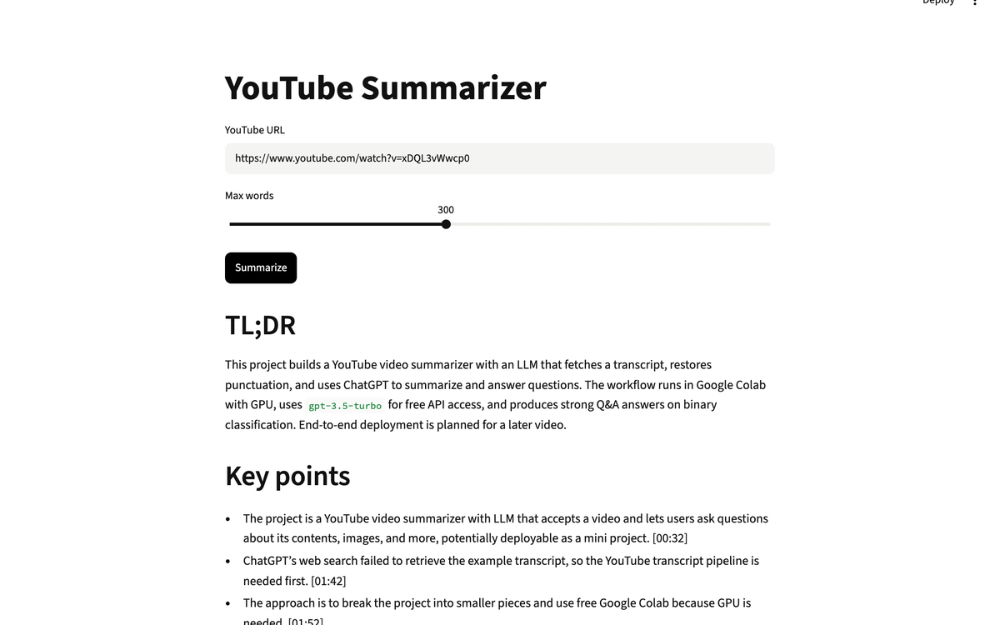
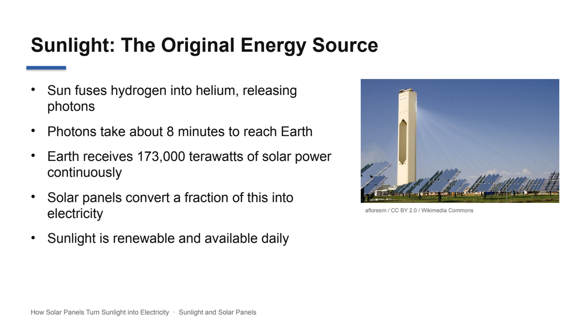
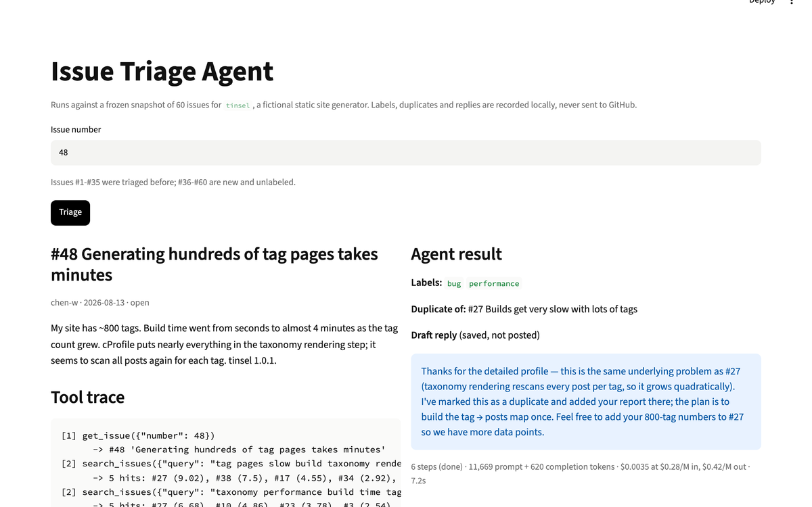
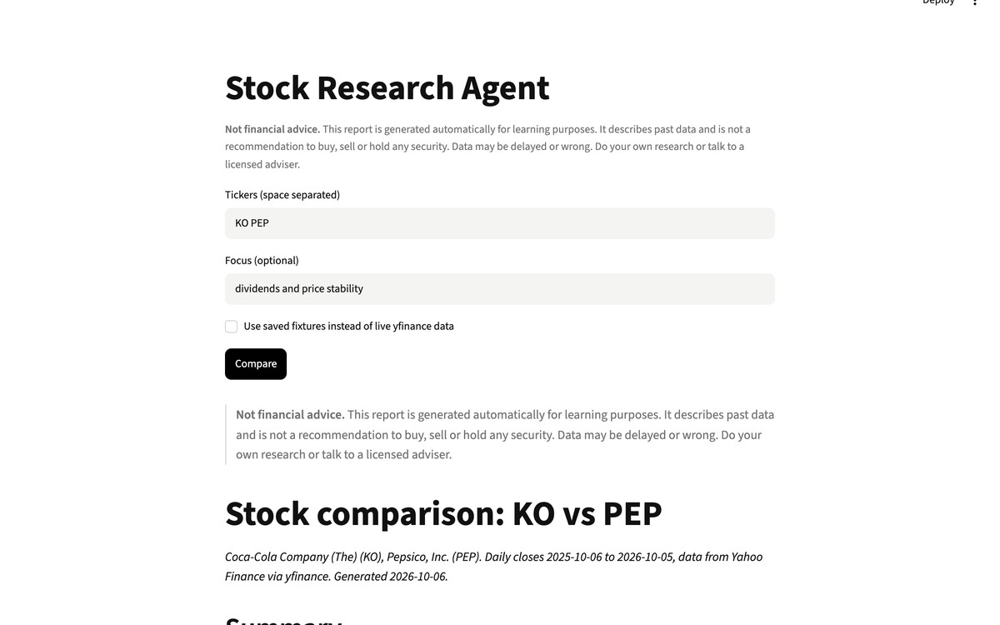
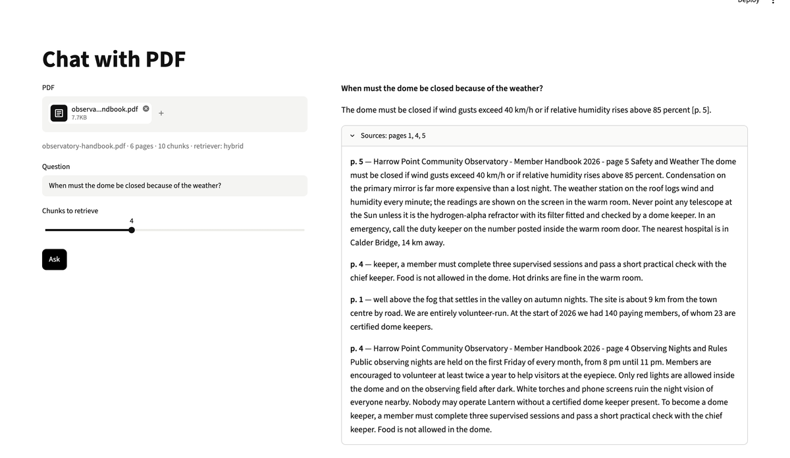
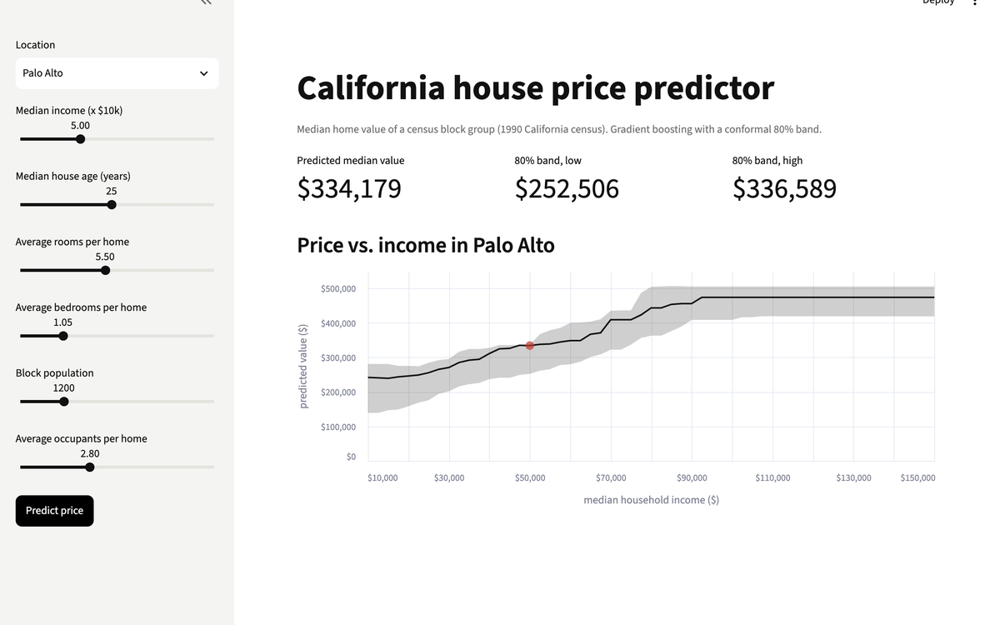

<div align="center">

# Awesome ML & AI Projects

**22 hands-on ML and AI projects. Working code, an eval that scores your build, offline tests and a real demo for each.**

Build them yourself, put them on your resume, beat the leaderboard. Free and open source.

Works with Ollama, DeepSeek, GPT, Claude, Gemini, Llama, Qwen and any OpenAI-compatible model.

**[Video walkthroughs on YouTube](https://www.youtube.com/@sreemantidey)** · **[Quick start](#-quick-start)** · **[Browse all projects](#-browse-all-projects)**

<br>

</div>

<table>
  <tr>
    <td width="33.3%" align="center">
      <a href="projects/llm-apps/youtube-summarizer/"></a>
      <sub><b>YouTube Summarizer</b></sub>
    </td>
    <td width="33.3%" align="center">
      <a href="projects/llm-apps/ppt-generator-agent/"></a>
      <sub><b>PPT Generator Agent</b></sub>
    </td>
    <td width="33.3%" align="center">
      <a href="projects/agents/github-issue-triage-agent/"></a>
      <sub><b>GitHub Issue Triage Agent</b></sub>
    </td>
  </tr>
  <tr>
    <td align="center">
      <a href="projects/agents/investment-research-agent/"></a>
      <sub><b>Investment Research Agent</b></sub>
    </td>
    <td align="center">
      <a href="projects/llm-apps/chat-with-pdf/"></a>
      <sub><b>Chat with PDF</b></sub>
    </td>
    <td align="center">
      <a href="projects/classic-ml/house-price-app/"></a>
      <sub><b>House Price App</b></sub>
    </td>
  </tr>
</table>

## 🚀 Quick start

```bash
git clone https://github.com/alexriderspy/awesome-ml-ai-projects.git
cd awesome-ml-ai-projects/projects/llm-apps/youtube-summarizer

pip install -r requirements.txt
ollama pull llama3.2                       # free local model, no API key
cp .env.example .env && export $(xargs < .env)

PYTHONPATH=src python -m yt_summarizer "https://www.youtube.com/watch?v=xDQL3vWwcp0"
PYTHONPATH=src python eval/run_eval.py     # score your build out of 100
```

To use a hosted model instead, set `LLM_BASE_URL`, `LLM_API_KEY` and `LLM_MODEL` in `.env`.

## 🧱 What's in every project

| | |
|---|---|
| `README.md` | milestones to build it yourself, run commands, scoring, leaderboard |
| `src/` | a working reference implementation |
| `app.py` | a Streamlit UI, where it makes sense |
| `eval/` | an original practice set and a scorer that prints `OVERALL <n>/100` |
| `tests/` | offline tests, no API key needed |
| `demo/` | real outputs and screenshots from a real run |

## 📂 Browse all projects

### 💬 LLM Apps

*Apps built on a language model, each with a checkable output.*

*   [▶️ YouTube Summarizer](projects/llm-apps/youtube-summarizer/) - Timestamped TL;DR, key points and chapters for any video · [video](https://www.youtube.com/watch?v=xDQL3vWwcp0)
*   [📊 PPT Generator Agent](projects/llm-apps/ppt-generator-agent/) - A topic in, a real .pptx deck out · [video](https://www.youtube.com/watch?v=xgSGGFDzu98)
*   [📄 Chat with PDF](projects/llm-apps/chat-with-pdf/) - Answers that cite page numbers, checked against the retrieved pages
*   [🧾 Structured Extraction](projects/llm-apps/structured-extraction/) - Messy receipts and job posts into validated JSON

### 🤖 AI Agents

*Tool-calling agents with the loop written by hand, no framework.*

*   [🛠️ Tool Calling Basics](projects/agents/tool-calling-basics/) - The call, run, return loop from scratch · [video](https://www.youtube.com/watch?v=XtjEE5E-GTw)
*   [✍️ Multi-Agent Blog Writer](projects/agents/multi-agent-blog-writer/) - Five agents research and write a post with real citations · [video](https://www.youtube.com/watch?v=KiMF4QJ-HOE)
*   [🐙 GitHub Issue Triage Agent](projects/agents/github-issue-triage-agent/) - Labels issues, finds duplicates, drafts replies
*   [🧑‍💻 Coding Agent that Fixes Failing Tests](projects/agents/coding-agent-fixes-tests/) - Edits code until pytest passes, without touching the tests
*   [🕸️ Web Scraping Agent](projects/agents/web-scraping-agent/) - Describe the data, get JSON records across pages
*   [📈 Investment Research Agent](projects/agents/investment-research-agent/) - Stock comparison reports where every number is checked
*   [💼 Recruitment Agent Team](projects/agents/recruitment-agent-team/) - Screening with evidence, interview questions, scheduling
*   [❌ Tic-Tac-Toe LLM Battle](projects/agents/tic-tac-toe-llm-battle/) - LLMs against each other and a perfect minimax player
*   [📰 Hacker News Briefing](projects/agents/hacker-news-briefing/) - A daily brief ranked by your interests
*   [🩺 Dependency Doctor](projects/agents/dependency-doctor/) - Finds stdlib deps, dead backports and yanked pins in requirements files

### 🔧 Fine-tuning

*Training code for a laptop, plus a Colab notebook for the full-size GPU run.*

*   [🦙 Fine-tune Llama 3.2 3B](projects/fine-tuning/finetune-llama-3.2-3b/) - LoRA SFT on FineTome-100k with Unsloth · [video](https://www.youtube.com/watch?v=dn2anUU0d0U)
*   [🗂️ Fine-tune on Your Own Data](projects/fine-tuning/finetune-on-your-own-data/) - Clean your notes and chats into a dataset, then train · [video](https://www.youtube.com/watch?v=OxfeK423y2I)
*   [🧮 Qwen2-VL LaTeX OCR](projects/fine-tuning/finetune-qwen2-vl-latex-ocr/) - Formula image to LaTeX with a vision-language model · [video](https://www.youtube.com/watch?v=i5kDh35sJ9M)
*   [⚖️ Small Model Beats Big](projects/fine-tuning/small-model-beats-big/) - A 360M model against a big API model on ticket routing

### 📐 Classic ML

*The fundamentals, end to end, no LLM needed.*

*   [📉 Linear Regression from Scratch](projects/classic-ml/linear-regression-from-scratch/) - Closed form and gradient descent in NumPy · [video](https://www.youtube.com/watch?v=Ho7WQBMQ038)
*   [🚢 Titanic](projects/classic-ml/titanic-kaggle/) - Your first Kaggle-style project · [video](https://www.youtube.com/watch?v=UPC8q_IUiLQ)
*   [🏠 House Price App](projects/classic-ml/house-price-app/) - A deployed model with an uncertainty band · [video](https://www.youtube.com/watch?v=1ZhBWDdRn6o)
*   [🌦️ Weather Prediction App](projects/classic-ml/weather-prediction-app/) - Tomorrow's temperature against a persistence baseline · [video](https://www.youtube.com/watch?v=DmCAFi896IU)

## 🏆 Post your score

Every project has a leaderboard. Run its eval, then open a pull request adding your row. See [CONTRIBUTING.md](CONTRIBUTING.md). New projects follow [CONVENTIONS.md](CONVENTIONS.md).

---

<div align="center">

⭐ **[Star the repo](https://github.com/alexriderspy/awesome-ml-ai-projects/stargazers)** to get notified when new projects drop.

<sub>MIT · See <a href="LICENSE">LICENSE</a></sub>

</div>
