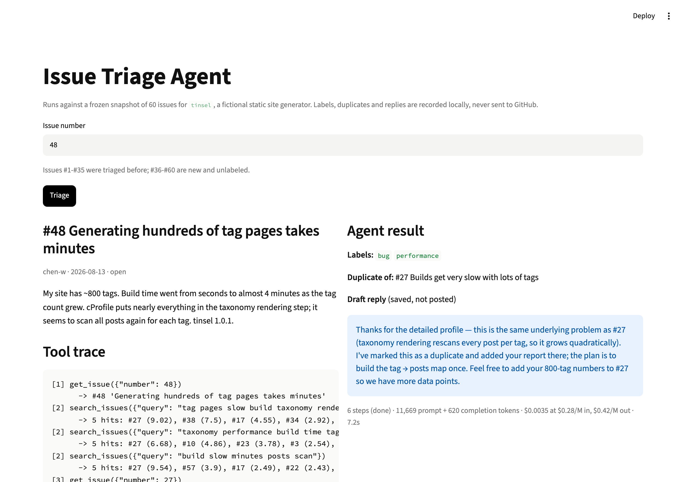

# GitHub Issue Triage Agent

An agent that labels new issues, spots duplicates of older ones and drafts a reply. It runs on a local snapshot and never touches GitHub.



**Level:** Intermediate · **Time:** ~4 hours · **Runs on:** laptop (Ollama) or any OpenAI-compatible API with tool calling

## What you'll learn

- Writing a tool-calling agent loop by hand
- Search for agents: BM25, and why the agent should try several queries
- Keeping write tools safe (simulated, limited to the issue being triaged)
- Measuring labels, duplicates and cost per issue

## The data

`data/issues.json` holds 60 original issues for a made-up static site generator. #1-#35 are already labelled; #36-#60 are new and get triaged. 12 of the new ones duplicate an older issue in different words. Answers live in `eval/gold.json`, which the agent never sees.

## How it works

```
issue #N ─► agent loop (max 10 steps)
              get_issue · search_issues (BM25) · apply_label · mark_duplicate · draft_reply
              (writes are recorded, never sent)
         ─► labels, duplicate_of, reply, tool trace, tokens
```

A real run on #44 ([`demo/run.md`](demo/run.md)): it searched three ways, opened #3, confirmed the same root cause, labelled `bug`, marked it a duplicate of #3 and drafted a reply. 6 turns, ~13k tokens.

## Milestones

- [ ] **1. Search** – load the snapshot, BM25 over title + body (`snapshot.py`)
- [ ] **2. Tools** – five tool schemas with argument checks (`tools.py`)
- [ ] **3. Agent loop** – step cap, trace, token count (`agent.py`)
- [ ] **4. CLI and UI** – `python -m issue_triage triage 44` and Streamlit (`app.py`)
- [ ] **5. Eval** – score 90+ on the 25 new issues (`eval/run_eval.py`)

## Run it

```bash
pip install -r requirements.txt
cp .env.example .env && export $(xargs < .env)

PYTHONPATH=src python -m issue_triage triage 44
PYTHONPATH=src python -m issue_triage triage --all --out results.json
streamlit run app.py
```

## Score it

```bash
PYTHONPATH=src python eval/run_eval.py
pytest -q tests
```

| Part | Weight | Checks |
|---|---|---|
| Labels | 40% | micro-F1 over (issue, label) pairs |
| Duplicates | 30% | F1 against the 12 gold pairs |
| Replies | 20% | a reply exists and references the duplicate |
| Efficiency | 10% | tokens per issue (full marks at 15k or less) |

## Leaderboard

| Builder | Model | Score |
|---|---|---|
| reference | deepseek-flash | 99.4 |

## Stretch goals

- Swap BM25 for embeddings and compare duplicate recall
- Triage all new issues in one conversation and compare cost
- Build a snapshot from a real public repo and triage it offline
