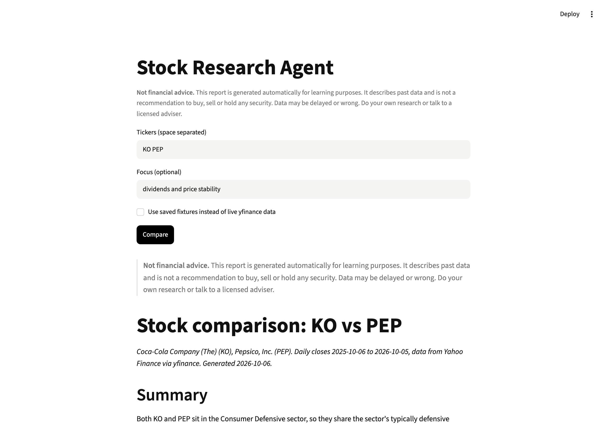

# Investment Research Agent

Give it a few tickers. An agent pulls a year of prices and fundamentals from yfinance and writes a comparison report. Python computes every number; the model only quotes them.

> **Not financial advice.** A learning project. Reports describe past data and never say buy, sell or hold.



Example report: [`demo/report-MSFT-GOOGL-NVDA.md`](demo/report-MSFT-GOOGL-NVDA.md) · trace: [`demo/run.md`](demo/run.md)

**Level:** Intermediate · **Time:** ~3 hours · **Runs on:** laptop (Ollama) or any OpenAI-compatible API with tool calling

## What you'll learn

- An agent loop with parallel tool calls
- Keeping the LLM away from arithmetic
- Checking model output in code and asking for a repair
- Saving live API data as fixtures so tests repeat exactly

## How it works

```
tickers ─► agent loop ─► get_price_history · get_fundamentals · compute_metrics · compare
        ─► narrative ─► check: sections, advice phrases, every number came from a tool
        ─► repair (max 2) ─► report = disclaimer + narrative + comparison table
```

Metrics (`metrics.py`): 1M/6M/1Y return, annualised volatility, max drawdown, plus market cap, P/E, margins, dividend yield and beta as reported.

## Milestones

- [ ] **1. Data** – yfinance, plus saved fixtures (`data.py`)
- [ ] **2. Metrics** – returns, volatility, drawdown (`metrics.py`)
- [ ] **3. Tools** – schemas and a dispatcher (`tools.py`)
- [ ] **4. Agent** – loop, self-check, repair, report (`agent.py`)
- [ ] **5. UI** – Streamlit (`app.py`)
- [ ] **6. Eval** – score 95+ (`eval/run_eval.py`)

## Run it

```bash
pip install -r requirements.txt
cp .env.example .env && export $(xargs < .env)

PYTHONPATH=src python -m stock_research KO PEP --out report.md
PYTHONPATH=src python -m stock_research KO PEP --fixtures eval/fixtures   # offline
streamlit run app.py
```

## Score it

```bash
PYTHONPATH=src python eval/run_eval.py
pytest -q
```

4 comparison requests on data saved on 2026-10-06.

| Part | Weight | Checks |
|---|---|---|
| Number accuracy | 40% | every number in the report matches a computed value |
| Sections | 20% | all required sections present |
| Disclaimer | 15% | at the top and the bottom |
| No advice | 15% | no buy/sell/recommend phrases |
| Coverage | 10% | every ticker discussed |

## Leaderboard

| Builder | Model | Score |
|---|---|---|
| reference | deepseek-flash | 98.8 |

## Stretch goals

- Check that each number sits next to the right ticker, not just that it exists
- Compute beta against an index ETF yourself
- Chart the normalised price series in the app

Data comes from Yahoo Finance through the unofficial `yfinance` library, for personal and educational use.
