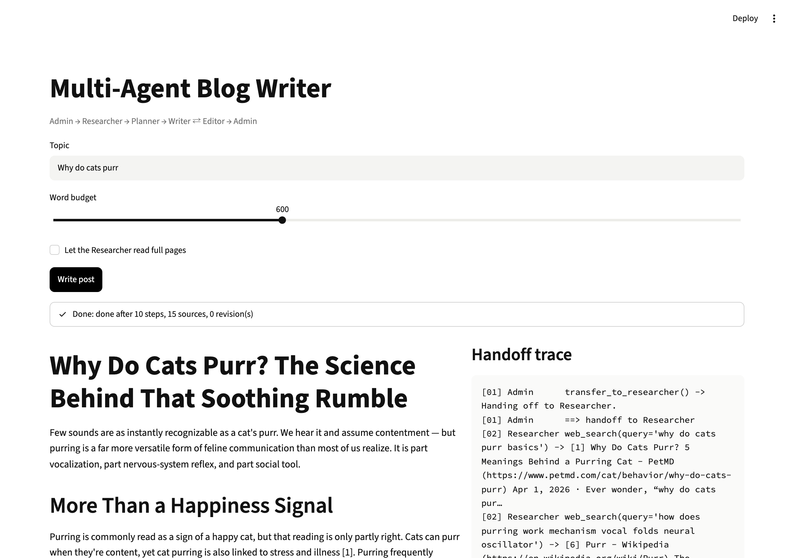

# Multi-Agent Blog Writer

Five agents (Admin, Researcher, Planner, Writer, Editor) hand off to each other to research a topic and write a blog post whose citations link to real search results.



**Level:** Intermediate · **Time:** ~3 hours · **Runs on:** laptop (Ollama) or any OpenAI-compatible API with tool calling

Video: [Multi-agent blog writer](https://www.youtube.com/watch?v=KiMF4QJ-HOE)

## What you'll learn

- How handoffs work underneath: a handoff is a tool that returns another agent
- A runner loop that swaps agents, caps steps and logs every tool call
- Grounding a writer: citations must come from search results
- An editor that checks the draft and can send it back once

The video used OpenAI's Swarm, which is now archived. Its core idea is small, so `swarm.py` rebuilds it in about 150 lines.

## How it works

```
topic ─► Admin ─► Researcher: web_search ×2-4, fetch_page (optional)
               ─► Planner: save_outline
               ─► Writer: save_draft (citations checked against search results)
               ─► Editor: check_draft ─► approve, or request_revision (once)
               ─► Admin: publish
```

## Milestones

- [ ] **1. Runner** – agents, tool schemas, handoffs, step cap (`swarm.py`)
- [ ] **2. Search** – live search and a cached search for tests (`search.py`)
- [ ] **3. Team** – the five agents and their tools (`team.py`)
- [ ] **4. Checks** – word budget, structure, citations (`checks.py`)
- [ ] **5. UI** – the post and the handoff trace (`app.py`)
- [ ] **6. Eval** – score 85+ (`eval/run_eval.py`)

## Run it

```bash
pip install -r requirements.txt
cp .env.example .env && export $(xargs < .env)

PYTHONPATH=src python -m blog_writer "How the James Webb Space Telescope keeps its instruments cold" --words 600 --out post.md
streamlit run app.py
```

Live run: [`demo/run.md`](demo/run.md) (trace) and [`demo/post-james-webb-space-telescope-cooling.md`](demo/post-james-webb-space-telescope-cooling.md) (post).

## Score it

```bash
PYTHONPATH=src python eval/run_eval.py
pytest -q tests
```

4 original topics with cached search results, so the eval needs no network.

| Part | Weight | Checks |
|---|---|---|
| Fact coverage | 40% | required facts appear in the post |
| Citations | 30% | every citation maps to a URL search returned |
| Structure | 15% | title, intro, sections, conclusion, sources |
| Word budget | 15% | within 75-115% of the budget |

## Leaderboard

| Builder | Model | Score |
|---|---|---|
| reference | deepseek-flash | 100.0 |

## Stretch goals

- Harder cases: search results with wrong numbers mixed in
- A fact-checker agent that checks each cited sentence against its source
- Rebuild the team on the OpenAI Agents SDK and compare
