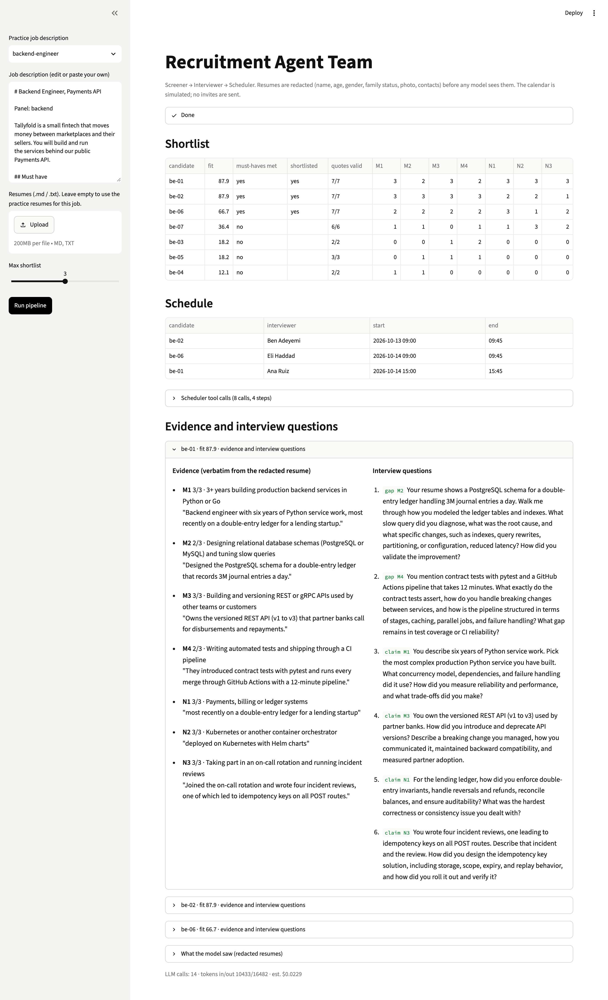

# Recruitment Agent Team

Three agents work through a job description and a pile of resumes: a screener ranks candidates with quotes from each resume, an interviewer writes questions, and a scheduler books interviews on a simulated calendar. Names, age, gender and family details are stripped in code before the model sees anything.



**Level:** Intermediate · **Time:** ~4 hours · **Runs on:** laptop (Ollama) or any OpenAI-compatible API

## What you'll learn

- Structured output you can verify: every score needs an exact quote from the resume
- A fairness guard written as code, tested with counterfactual resumes
- A tool-calling scheduler that can't double-book
- Scoring a multi-agent pipeline without an LLM judge

## How it works

```
resumes ─► redactor (code) ─► Screener ─► quote check ─► retry once ─► ranked shortlist
                                              │
                         ┌────────────────────┴────────────────────┐
                    Interviewer                          Scheduler (tool loop)
                 questions per candidate      list_free_slots · book_slot · finish
```

## Milestones

- [ ] **1. Redactor** – strip protected attributes, pass the counterfactual tests (`redact.py`)
- [ ] **2. Screener** – scores with verbatim evidence, retry on bad quotes (`screener.py`)
- [ ] **3. Interviewer** – 4-6 questions per shortlisted candidate (`interviewer.py`)
- [ ] **4. Scheduler** – tool loop over a simulated calendar (`scheduler.py`)
- [ ] **5. UI and CLI** – `python -m recruit_team` and Streamlit (`app.py`)
- [ ] **6. Eval** – score 90+ (`eval/run_eval.py`)

## Run it

```bash
pip install -r requirements.txt
cp .env.example .env && export $(xargs < .env)

PYTHONPATH=src python -m recruit_team \
  --jd eval/practice/support-lead/jd.md \
  --resumes eval/practice/support-lead/resumes \
  --out out/support-lead
streamlit run app.py
```

Example output: [`demo/support-lead/`](demo/support-lead/)

## Score it

```bash
PYTHONPATH=src python eval/run_eval.py
pytest -q
```

3 job descriptions and 20 original resumes, with a gold shortlist per job and a counterfactual twin that changes only name, gender, pronouns and age.

| Part | Weight | Checks |
|---|---|---|
| Shortlist F1 | 50% | against the gold shortlist |
| Evidence | 25% | quotes are exact spans of the resume |
| Schedule | 15% | everyone booked once, no double bookings |
| Fairness | 10% | the twin gets the same decision |

## Leaderboard

| Builder | Model | Score |
|---|---|---|
| reference | deepseek-flash | 96.7 |

## Stretch goals

- Screen each resume 3 times and take the median to cut score noise
- Extract requirements from free-form job descriptions
- PDF and DOCX resumes
