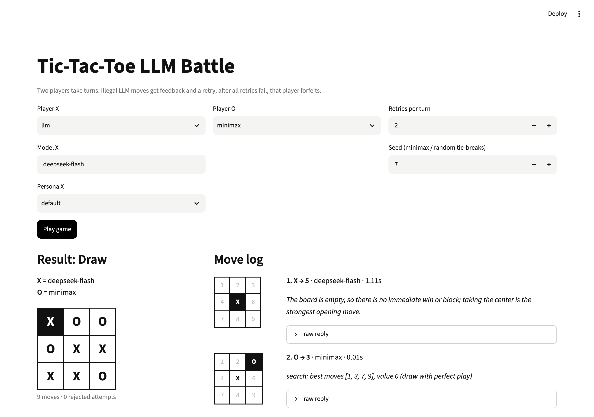

# Tic-Tac-Toe LLM Battle

Two LLMs play tic-tac-toe against each other, against a perfect minimax player, or against a random mover. Illegal moves are sent back to the model with the reason.



**Level:** Beginner · **Time:** ~3 hours · **Runs on:** laptop (Ollama) or any OpenAI-compatible API

## What you'll learn

- A small game engine: board, win detection, move validation
- Minimax, and proving it never loses
- Getting a structured move out of an LLM and retrying with feedback
- Measuring a model against a perfect opponent

## How it works

```
board ─► player: LLM (JSON move) | minimax | random
      ─► validate ─► legal: play  /  illegal: feedback and retry (2 times), then forfeit
```

## Milestones

- [ ] **1. Board** – win/draw detection and move parsing (`board.py`)
- [ ] **2. Minimax** – a perfect player, tested on every possible game (`players.py`)
- [ ] **3. LLM player** – prompt, JSON reply, personas (`players.py`)
- [ ] **4. Game loop** – retries, forfeit, move log (`game.py`)
- [ ] **5. UI** – watch games move by move (`app.py`)
- [ ] **6. Eval** – draw every game against minimax (`eval/run_eval.py`)

## Run it

```bash
pip install -r requirements.txt
cp .env.example .env && export $(xargs < .env)

PYTHONPATH=src python -m ttt_battle --x llm --o minimax
PYTHONPATH=src python -m ttt_battle --x llm --o llm --persona-x aggressive --persona-o cautious
streamlit run app.py
```

Transcripts: [`demo/run.md`](demo/run.md)

## Score it

```bash
PYTHONPATH=src python eval/run_eval.py
pytest -q tests
```

The LLM plays minimax 4 times as X and 4 times as O, then solves 8 original positions with one correct move.

| Part | Weight | Checks |
|---|---|---|
| Non-loss rate | 60% | draws or wins against minimax |
| Legal moves | 20% | share of legal attempts |
| Tactics | 20% | positions solved on the first try |

## Leaderboard

| Builder | Model | Score |
|---|---|---|
| reference | deepseek-flash | 100.0 |

## Stretch goals

- A round-robin tournament between models with an Elo table
- 4x4 tic-tac-toe or Connect Four
- Check whether the model's stated reasoning matches its move
