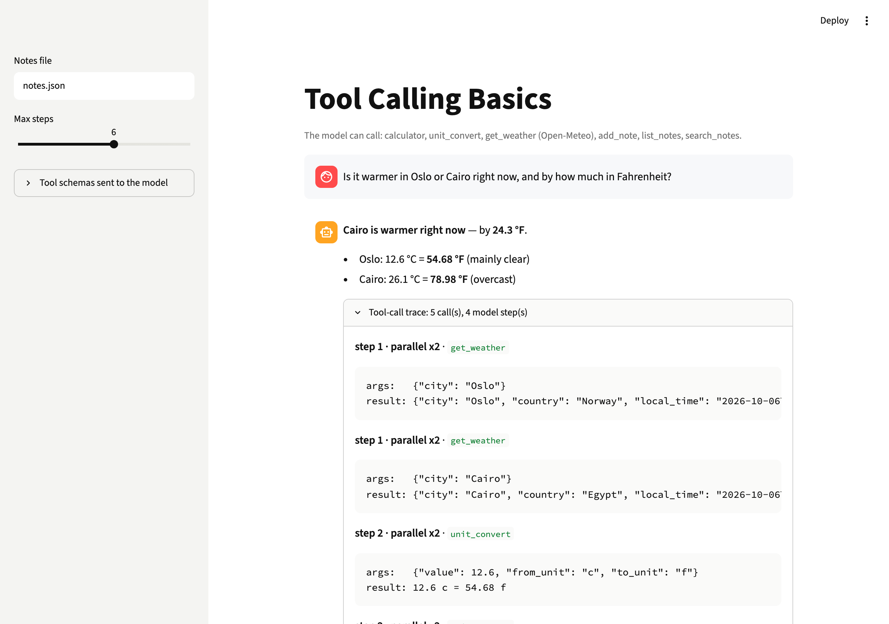

# Tool Calling Basics

Let an LLM call your Python functions. Schemas are built from type hints and docstrings, and the call → run → return loop is written by hand.



**Level:** Beginner · **Time:** ~2 hours · **Runs on:** laptop (Ollama) or any OpenAI-compatible API with tool calling

Video: [Tool calling from scratch](https://www.youtube.com/watch?v=XtjEE5E-GTw)

## What you'll learn

- Turning a function signature into a tool schema
- The tool-calling loop, including parallel calls
- Turning tool errors into messages the model can recover from
- Safe tools: an AST calculator instead of `eval()`

## How it works

```
@tool functions ─► JSON schemas
question ─► LLM ─► tool calls? ─ no ─► answer
              ▲         │ yes
              │    check args ─► run tools (in parallel) ─► result or "Error: ..."
              └──────── tool messages
```

Tools: calculator, unit converter, weather (Open-Meteo, no key), and a notes store.

## Milestones

- [ ] **1. Schemas** – functions to tool definitions, argument checks (`schema.py`)
- [ ] **2. Tools** – calculator, units, weather, notes (`toolbox.py`)
- [ ] **3. Loop** – step cap, parallel calls, error strings, trace (`agent.py`)
- [ ] **4. CLI and UI** – `python -m tool_calling` and Streamlit (`app.py`)
- [ ] **5. Eval** – score 90+ on 15 tasks (`eval/run_eval.py`)

## Run it

```bash
pip install -r requirements.txt
cp .env.example .env && export $(xargs < .env)

PYTHONPATH=src python -m tool_calling --schemas
PYTHONPATH=src python -m tool_calling "Is it warmer in Oslo or Cairo right now?"
streamlit run app.py
```

Transcripts: [`demo/run.md`](demo/run.md)

## Score it

```bash
PYTHONPATH=src python eval/run_eval.py
pytest -q tests
```

15 original tasks: arithmetic, conversions, weather (stubbed so scores don't change), notes, parallel calls and tool errors.

| Part | Weight | Checks |
|---|---|---|
| Answer | 70% | expected numbers and phrases appear |
| Tool choice | 30% | the right tools were called |

## Leaderboard

| Builder | Model | Score |
|---|---|---|
| reference | deepseek-flash | 99.0 |

## Stretch goals

- A `get_forecast(city, days)` tool
- Ask the user before running a tool that writes
- Run the eval on a small local model and compare
