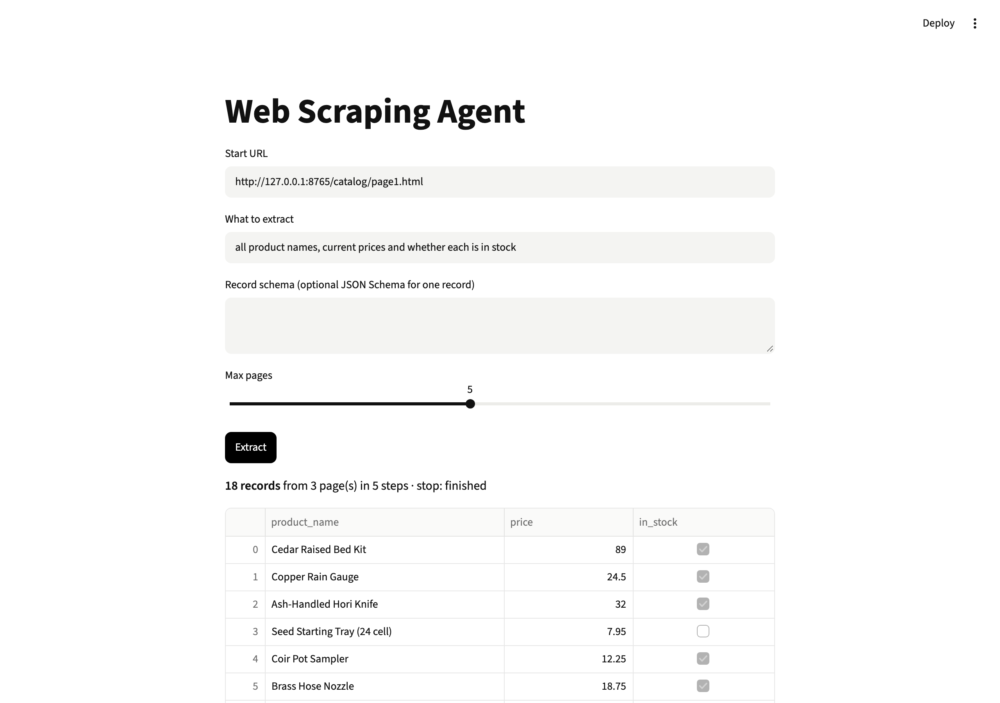

# Web Scraping Agent

Describe what you want ("all product names and prices") and give a URL. An agent fetches the page, reads a cleaned version, saves records that match a JSON schema, and follows "next page" links.



**Level:** Intermediate · **Time:** ~4 hours · **Runs on:** laptop (Ollama) or any OpenAI-compatible API

## What you'll learn

- Turning messy HTML into compact markdown an LLM can read
- A tool-calling agent loop with a step cap
- Validating every record against a schema and sending errors back
- Scoring extraction with field-level F1

## How it works

```
description ─► record schema (yours or generated)
URL ─► agent loop: fetch_page (robots.txt, clean HTML) · save_records (validate) · finish
    ─► records (JSON / table) + tool log
```

## Milestones

- [ ] **1. Fetch** – httpx, robots.txt, size cap (`fetch.py`)
- [ ] **2. Clean** – HTML to markdown, keep tables and links (`clean.py`)
- [ ] **3. Schema** – generate, validate and coerce records (`schema.py`)
- [ ] **4. Agent** – tools, step cap, page cap (`agent.py`)
- [ ] **5. UI** – URL in, table out (`app.py`)
- [ ] **6. Eval** – score 90+ (`eval/run_eval.py`)

## Run it

```bash
pip install -r requirements.txt
cp .env.example .env && export $(xargs < .env)

python -m http.server 8765 --bind 127.0.0.1 --directory eval/sites &
PYTHONPATH=src python -m scrape_agent http://127.0.0.1:8765/catalog/page1.html "all product names and prices"
streamlit run app.py
```

Keep `--max-pages` low on real sites and check their terms first.

## Score it

```bash
PYTHONPATH=src python eval/run_eval.py
pytest -q
```

5 original sites served from localhost (a shop, job board, events table, blog, package registry), each with expected records. Score = mean field-level F1 × 100.

## Leaderboard

| Builder | Model | Score |
|---|---|---|
| reference | deepseek-flash | 100.0 |

## Stretch goals

- A Playwright fetcher for JavaScript-rendered pages
- Open each item's detail page to fill missing fields
- Find the JSON API behind "load more" buttons
