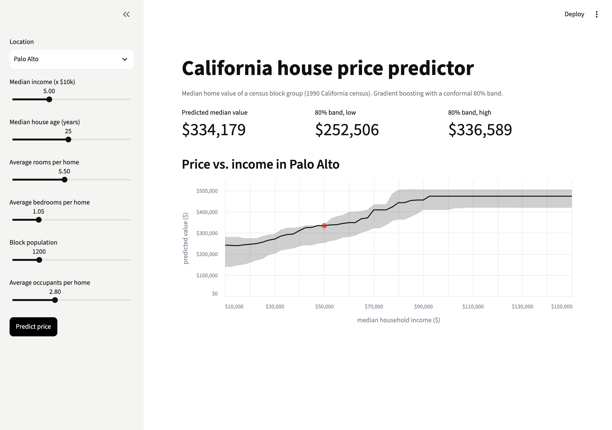

# California House Price App

Train a house price model on the California housing data and serve it in a Streamlit app that shows a price with an 80% uncertainty band.



**Level:** Beginner · **Time:** ~3 hours · **Runs on:** any laptop (trains in ~15 s)

Video: [End-to-end house price prediction app](https://www.youtube.com/watch?v=1ZhBWDdRn6o)

## What you'll learn

- A scikit-learn `Pipeline` so serving runs the same code as training
- Gradient boosting for tabular data, compared with a linear model
- Prediction intervals with quantile regression, calibrated with a held-out set
- Saving a model with `joblib` and loading it in an app

## How it works

```
fetch_california_housing ─► 80/20 split
  ─► point model: engineered features ─► HistGradientBoosting
  ─► band: quantile models (10%, 90%) ─► widened on a calibration set
  ─► artifacts/house_price.joblib ─► app.py
```

The target is the median home value of a census block group (1990), in $100k. Values are capped at $500k.

## Milestones

- [ ] **1. Data** – download, cache, fixed split (`model.py`)
- [ ] **2. Pipeline** – engineered features + GBM (`model.py`)
- [ ] **3. Uncertainty** – quantile models + calibration (`HousePriceModel.fit`)
- [ ] **4. Artifact** – train once, save, reload (`python -m house_price train`)
- [ ] **5. App** – sliders, price, band, chart (`app.py`)
- [ ] **6. Eval** – RMSE, MAE and band coverage (`eval/run_eval.py`)

## Run it

```bash
pip install -r requirements.txt

PYTHONPATH=src python -m house_price train
PYTHONPATH=src python -m house_price predict --MedInc 8 --Latitude 37.44 --Longitude -122.14
streamlit run app.py
```

## Score it

```bash
python eval/run_eval.py
pytest -q
```

| Part | Weight | Checks |
|---|---|---|
| RMSE skill | 50% | `1 - RMSE / RMSE of predicting the mean` |
| MAE skill | 25% | same with MAE |
| Calibration | 25% | the 80% band holds 80% of test prices |

| Model | RMSE | MAE |
|---|---|---|
| predict the mean | 1.145 | 0.906 |
| linear regression | 0.746 | 0.533 |
| gradient boosting | 0.444 | 0.289 |

Band coverage: 0.791 (target 0.80). 100 is not reachable on noisy data like this.

## Leaderboard

| Builder | Model | Score |
|---|---|---|
| reference | HistGradientBoosting + calibrated band | 72.4 |

## Stretch goals

- Nearest-neighbour location features, computed without leakage
- LightGBM or XGBoost, compared on RMSE and training time
- SHAP values for the current prediction
