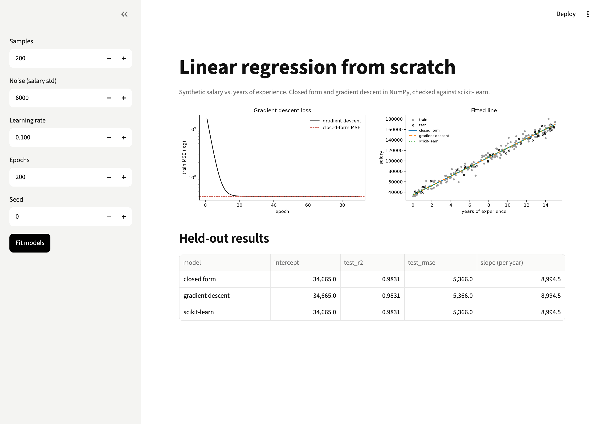
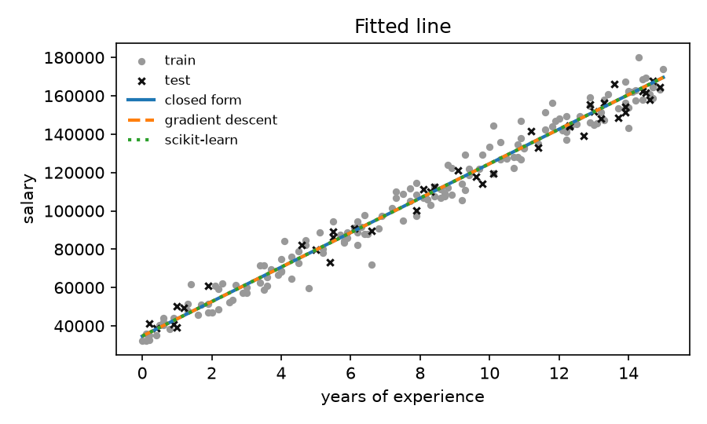

# Linear Regression from Scratch

Fit salary against years of experience with only NumPy, two ways (the normal equation and gradient descent), and check both against scikit-learn.



**Level:** Beginner · **Time:** ~2 hours · **Runs on:** any laptop, no downloads

Video: [Implement regression from scratch](https://www.youtube.com/watch?v=Ho7WQBMQ038)

## What you'll learn

- What fitting a line means: minimising mean squared error
- The closed-form solution, and why `lstsq` beats inverting a matrix
- Gradient descent, learning rates, and divergence
- Standardising features, and held-out R² and RMSE

## How it works

```
synthetic data (salary = 35,000 + 9,000 × years + noise) ─► 80/20 split
   ├─► closed form (lstsq)
   ├─► gradient descent (standardised)
   └─► scikit-learn (reference)
   ─► R², RMSE, coefficient agreement, plots
```

## Milestones

- [ ] **1. Data** – seeded synthetic data and a split (`data.py`)
- [ ] **2. Closed form** – normal equation, R² and RMSE (`model.py`)
- [ ] **3. Gradient descent** – batch GD with a loss history (`model.py`)
- [ ] **4. Plots** – loss curve and fitted line (`plots.py`)
- [ ] **5. UI** – play with noise, learning rate and epochs (`app.py`)
- [ ] **6. Eval** – score 100 (`eval/run_eval.py`)

## Run it

```bash
pip install -r requirements.txt

PYTHONPATH=src python -m linreg --plots demo
PYTHONPATH=src python -m linreg --multi --epochs 2000
streamlit run app.py
```



## Score it

```bash
python eval/run_eval.py
pytest -q
```

5 dataset settings (small, noisy, two features, 5,000 rows).

| Part | Weight | Checks |
|---|---|---|
| Closed-form agreement | 30% | matches scikit-learn |
| GD agreement | 30% | gradient descent reaches the same coefficients |
| Held-out R² | 25% | compared with scikit-learn |
| Noise floor | 15% | RMSE close to the noise in the data |

## Leaderboard

| Builder | Model | Score |
|---|---|---|
| reference | NumPy closed form + GD | 100.0 |

## Stretch goals

- Mini-batch and stochastic gradient descent
- Ridge regularisation in both methods
- Polynomial features on curved data
