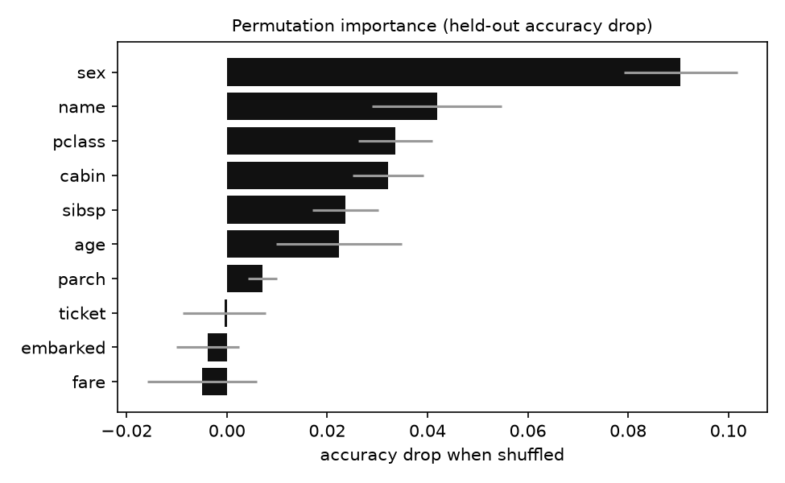

# Titanic: Your First Kaggle Project

Predict who survived the Titanic, going through the whole Kaggle loop: EDA, features, baselines, gradient boosting, cross-validation and a submission file.



```
== 5-fold CV accuracy ==
  majority     0.6179
  gender_rule  0.7740
  logistic     0.7969
  gbm          0.7926
hidden-test accuracy (gbm): 0.8219
```

**Level:** Beginner · **Time:** ~3 hours · **Runs on:** any laptop

Video: [Titanic, a first Kaggle project](https://www.youtube.com/watch?v=UPC8q_IUiLQ)

## What you'll learn

- Spotting target leakage (the `boat` column is basically the answer)
- Features from messy text: titles, decks, fare per person
- Baselines first, then a stronger model
- Keeping feature engineering inside a pipeline so cross-validation stays honest

## How it works

```
OpenML titanic ─► drop leaky columns ─► 70/30 split (test labels kept aside)
  ─► features (title, family size, deck, fare/person) ─► 5-fold CV of 4 models
  ─► submission.csv ─► permutation importance
```

The data is the OpenML copy (1,309 passengers), so you don't need a Kaggle account. Numbers aren't comparable to the Kaggle leaderboard.

## Milestones

- [ ] **1. Data** – download, cache, drop leakage, split (`data.py`)
- [ ] **2. EDA** – survival by sex, class, title, age (`eda.py`)
- [ ] **3. Features** – a transformer that learns its fill values in `fit` (`features.py`)
- [ ] **4. Models** – baselines and gradient boosting with CV (`models.py`)
- [ ] **5. Submission** – write and check the CSV (`submission.py`)

## Run it

```bash
pip install -r requirements.txt
PYTHONPATH=src python -m titanic --out outputs
```

## Score it

```bash
python eval/run_eval.py
pytest -q
```

Score = 5-fold CV accuracy of the gradient boosting pipeline × 100. Accuracy on the held-out rows is reported too.

## Leaderboard

| Builder | Model | CV | Hidden test |
|---|---|---|---|
| reference | HistGradientBoosting + engineered features | 79.3 | 82.2 |

## Stretch goals

- Tune with nested cross-validation
- A ticket-group feature, without leaking labels
- Download the real Kaggle files and submit
