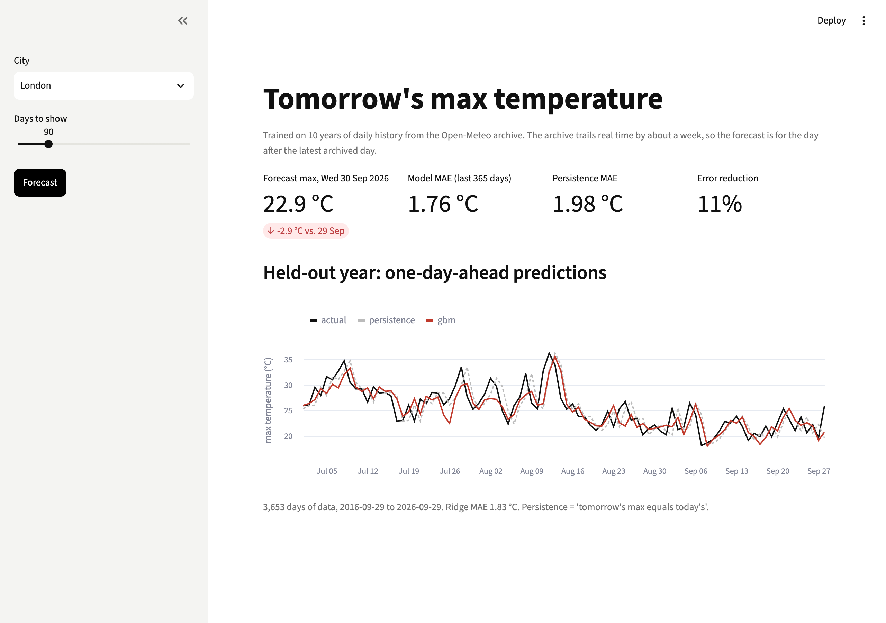

# Weather Prediction App

Pick a city, pull 10 years of daily weather from Open-Meteo, and predict tomorrow's maximum temperature. The model has to beat "tomorrow will be like today".



**Level:** Beginner · **Time:** ~3 hours · **Runs on:** any laptop (internet for the first fetch)

Video: [Weather prediction app](https://www.youtube.com/watch?v=DmCAFi896IU)

## What you'll learn

- Calling a public API and caching the results
- Time-series features: lags, rolling means, day of year
- Splitting by time, never shuffling
- Persistence baselines, and predicting the change instead of the level

## How it works

```
city ─► Open-Meteo archive ─► cached CSV
     ─► features for day t (lags, rolling means, pressure change, season)
     ─► train on all but the last year, test on the last year
        persistence | ridge | gradient boosting
```

Open-Meteo's archive trails real time by a few days, so the app's "tomorrow" is about a week ago. Weather data by [Open-Meteo.com](https://open-meteo.com/), CC BY 4.0.

## Milestones

- [ ] **1. Fetch** – call the API, cache, retry (`fetch.py`)
- [ ] **2. Features** – lags and rolling stats that only look back (`features.py`)
- [ ] **3. Models** – persistence, ridge, GBM, time split (`model.py`)
- [ ] **4. App** – city picker, metrics, chart (`app.py`)
- [ ] **5. Eval** – beat persistence in six cities (`eval/run_eval.py`)

## Run it

```bash
pip install -r requirements.txt

PYTHONPATH=src python -m weather London
streamlit run app.py
```

## Score it

```bash
python eval/run_eval.py
pytest -q
```

Trained on 2015-2023, tested on 2024. Score = how much the model cuts the error of "tomorrow = today", in percent, averaged over six cities. 0 means no better than persistence. Next-day weather from one city's history has a low ceiling, so expect 10-25.

| City | Persistence MAE | GBM MAE | Score |
|---|---|---|---|
| London | 1.86 °C | 1.59 °C | 14.5 |
| New York | 2.94 °C | 2.49 °C | 15.2 |
| Delhi | 1.01 °C | 1.00 °C | 1.4 |
| Bengaluru | 0.90 °C | 0.85 °C | 5.8 |
| Tokyo | 2.28 °C | 1.92 °C | 15.7 |
| Sydney | 2.53 °C | 1.96 °C | 22.4 |

## Leaderboard

| Builder | Model | Score |
|---|---|---|
| reference | GBM on the daily change | 12.5 |

## Stretch goals

- Add neighbouring cities' weather as features
- Predict several days ahead and plot how the error grows
- Forecast the real tomorrow with the forecast API's `past_days`
