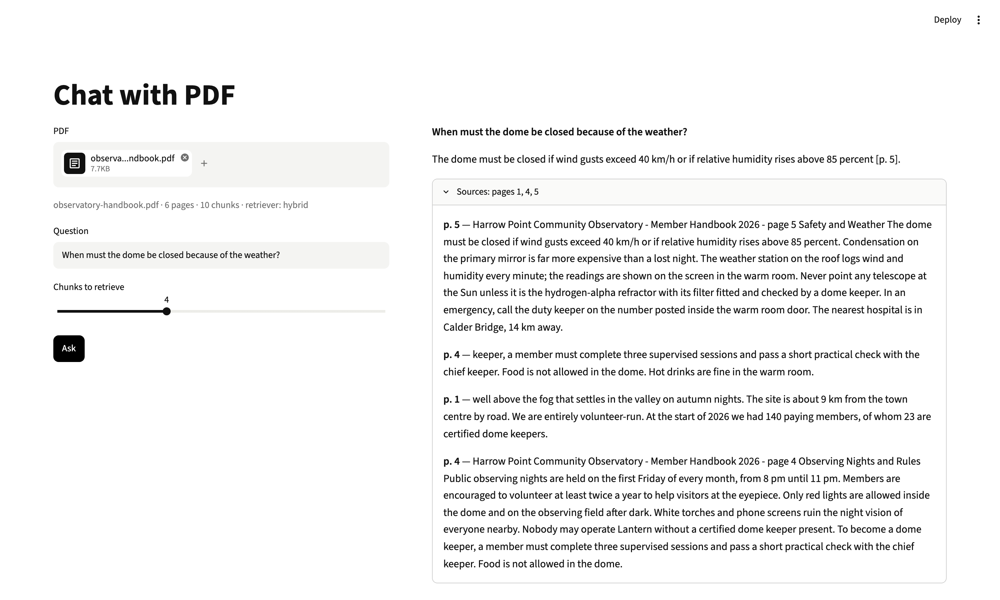

# Chat with PDF

Upload a PDF and ask questions. Answers cite page numbers like `[p. 5]`, and the app checks every cited page was in the text the model saw.



**Level:** Beginner · **Time:** ~3 hours · **Runs on:** laptop (Ollama) or any OpenAI-compatible API

## What you'll learn

- Extracting text page by page and chunking without losing page numbers
- BM25, local embeddings, and combining them (reciprocal rank fusion)
- Prompting for citations, then checking them
- Answering "Not in the document." instead of guessing

## How it works

```
PDF ─► pages ─► ~700-char chunks tagged with their page
question ─► BM25 | embeddings | hybrid ─► top chunks ─► LLM answer with [p. N]
         ─► flag any cited page that wasn't retrieved
```

## Milestones

- [ ] **1. Pages** – text per page, chunks that don't cross pages (`pdf.py`)
- [ ] **2. BM25** – a keyword retriever in plain Python (`retrieve.py`)
- [ ] **3. Hybrid** – embeddings + rank fusion (`retrieve.py`)
- [ ] **4. Cited answers** – prompt, parse and check citations (`answer.py`)
- [ ] **5. UI** – upload, ask, see sources (`app.py`)
- [ ] **6. Eval** – score 90+ (`eval/run_eval.py`)

## Run it

```bash
pip install -r requirements.txt
pip install sentence-transformers   # optional, for embeddings
cp .env.example .env && export $(xargs < .env)

PYTHONPATH=src python -m pdf_chat eval/practice/observatory-handbook.pdf "How much is a student membership?"
streamlit run app.py
```

## Score it

```bash
PYTHONPATH=src python eval/run_eval.py --retriever hybrid
pytest -q tests
```

An original 6-page handbook and 17 questions, two of them unanswerable.

| Part | Weight | Checks |
|---|---|---|
| Answer | 60% | required facts present; "Not in the document." when there's no answer |
| Citations | 40% | cited pages hold the fact |

| Retriever | Score |
|---|---|
| BM25 | 100.0 |
| Embeddings | 94.1 |
| Hybrid | 100.0 |

## Leaderboard

| Builder | Model | Retriever | Score |
|---|---|---|---|
| reference | deepseek-flash | hybrid | 100.0 |

## Stretch goals

- Questions whose answers span two pages, and tables
- OCR for scanned PDFs
- Follow-up questions rewritten into standalone ones
