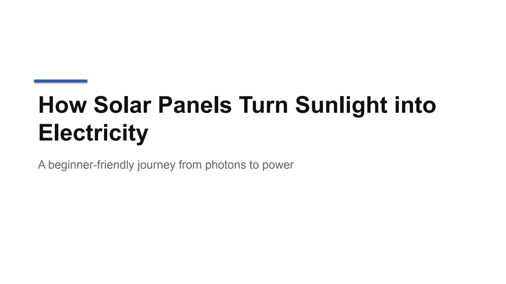
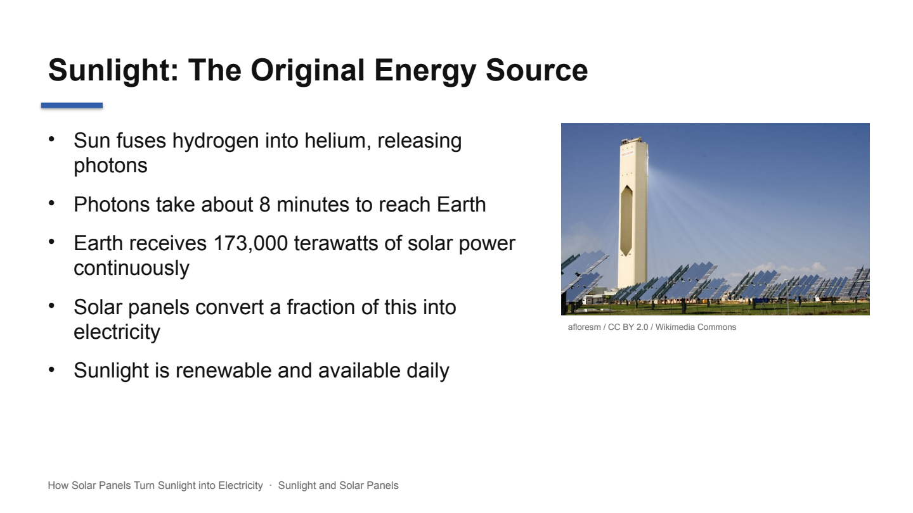
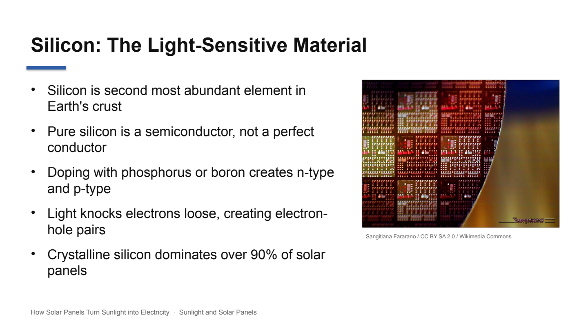
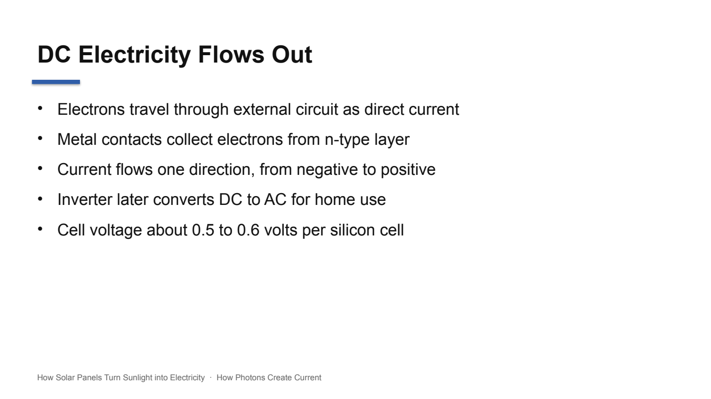

# PPT Generator Agent

Type a topic, get a real PowerPoint file. An LLM plans the outline as JSON, writes each slide, and python-pptx builds the deck with speaker notes and optional images.

| | |
|---|---|
|  |  |
|  |  |

Real slides from [`demo/solar-panels.pptx`](demo/solar-panels.pptx).

**Level:** Beginner · **Time:** ~3 hours · **Runs on:** laptop (Ollama) or any OpenAI-compatible API

Video: [PPT generator agent](https://www.youtube.com/watch?v=xgSGGFDzu98)

## What you'll learn

- Getting reliable JSON from an LLM: schema, validation, retry with the errors
- Splitting a big generation into steps (outline, then sections)
- Enforcing hard limits on slides and bullets
- Building .pptx files with python-pptx

## How it works

```
topic ─► LLM outline (JSON) ─► validate ─► retry if needed
      ─► LLM slides per section ─► validate (3-5 bullets, ≤12 words)
      ─► optional Wikimedia image (credited) ─► python-pptx ─► deck.pptx
```

## Milestones

- [ ] **1. Outline** – JSON outline validated with Pydantic (`plan.py`)
- [ ] **2. Retry** – send validation errors back (`plan.py`)
- [ ] **3. Deck** – 16:9 slides with speaker notes (`build.py`)
- [ ] **4. Images** – Wikimedia Commons with credits (`images.py`)
- [ ] **5. UI** – Streamlit with a download button (`app.py`)
- [ ] **6. Eval** – score 90+ (`eval/run_eval.py`)

## Run it

```bash
pip install -r requirements.txt
cp .env.example .env && export $(xargs < .env)

PYTHONPATH=src python -m ppt_agent "How solar panels turn sunlight into electricity" --slides 8 --images --out deck.pptx
streamlit run app.py
```

PNG previews need LibreOffice (`soffice`).

## Score it

```bash
PYTHONPATH=src python eval/run_eval.py
pytest -q tests
```

5 original topics.

| Part | Weight | Checks |
|---|---|---|
| JSON validity | 20% | replies parse and pass the schema first time |
| Slide count | 25% | matches the request |
| Bullet limits | 25% | 3-5 bullets, ≤12 words each |
| Coverage | 30% | key terms of the topic appear |

## Leaderboard

| Builder | Model | Score |
|---|---|---|
| reference | deepseek-flash | 99.0 |

## Stretch goals

- Use a company `.potx` template
- Chart slides from a small table
- Flag numbers in bullets that have no source
