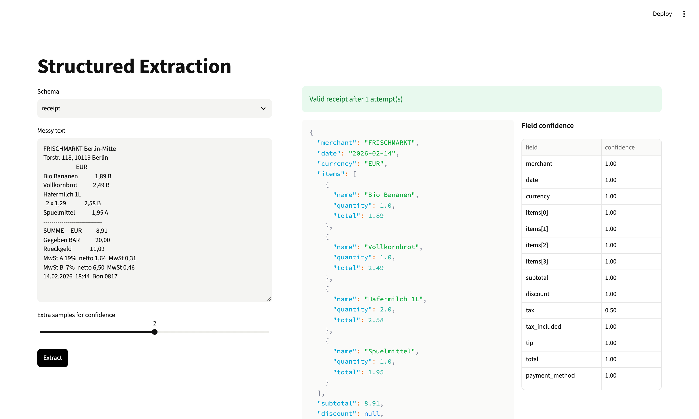

# Structured Extraction

Turn messy text (OCR'd receipts, job posts) into JSON that passes a Pydantic schema. Failed validation goes back to the model, and every field gets a confidence score.



**Level:** Beginner · **Time:** ~3 hours · **Runs on:** laptop (Ollama) or any OpenAI-compatible API

## What you'll learn

- Pydantic schemas whose descriptions double as instructions
- Validators that catch real mistakes (totals that don't add up)
- A retry loop that sends the exact error back
- Field-level confidence from two cheap signals

## How it works

```
text ─► LLM (schema in the prompt) ─► JSON ─► validate ─► error back to the LLM (up to 2 retries)
valid ─► extra samples ─► per field: value appears in the text? samples agree? ─► confidence
```

## Milestones

- [ ] **1. Schemas** – `Receipt` and `JobPost` with validators (`schemas.py`)
- [ ] **2. Extract** – schema in the prompt, validate the reply (`extract.py`)
- [ ] **3. Retry** – send validation errors back (`extract.py`)
- [ ] **4. Confidence** – grounding + sample agreement (`extract.py`)
- [ ] **5. UI** – paste text, see JSON and confidence (`app.py`)
- [ ] **6. Eval** – field F1 above 0.9 (`eval/run_eval.py`)

## Run it

```bash
pip install -r requirements.txt
cp .env.example .env && export $(xargs < .env)

PYTHONPATH=src python -m extractor job_post demo/input-job-post.txt --samples 2
streamlit run app.py
```

## Score it

```bash
PYTHONPATH=src python eval/run_eval.py
pytest -q tests
```

12 original documents (6 receipts, 6 job posts) with expected JSON.

| Part | Weight | Checks |
|---|---|---|
| Field F1 | 80% | fields and line items match |
| Schema-valid | 20% | final output passes the schema |

| Model | Score |
|---|---|
| deepseek-flash | 99.1 |
| qwen2.5:7b (Ollama) | 87.7 |

The retry loop matters for the smaller model: 4 of its 12 documents failed validation at first and were fixed after the error went back.

## Leaderboard

| Builder | Model | Score |
|---|---|---|
| reference | deepseek-flash | 99.1 |

## Stretch goals

- Compare with the provider's native structured output
- A third schema (invoices) with its own practice set
- Receipt photos as input
