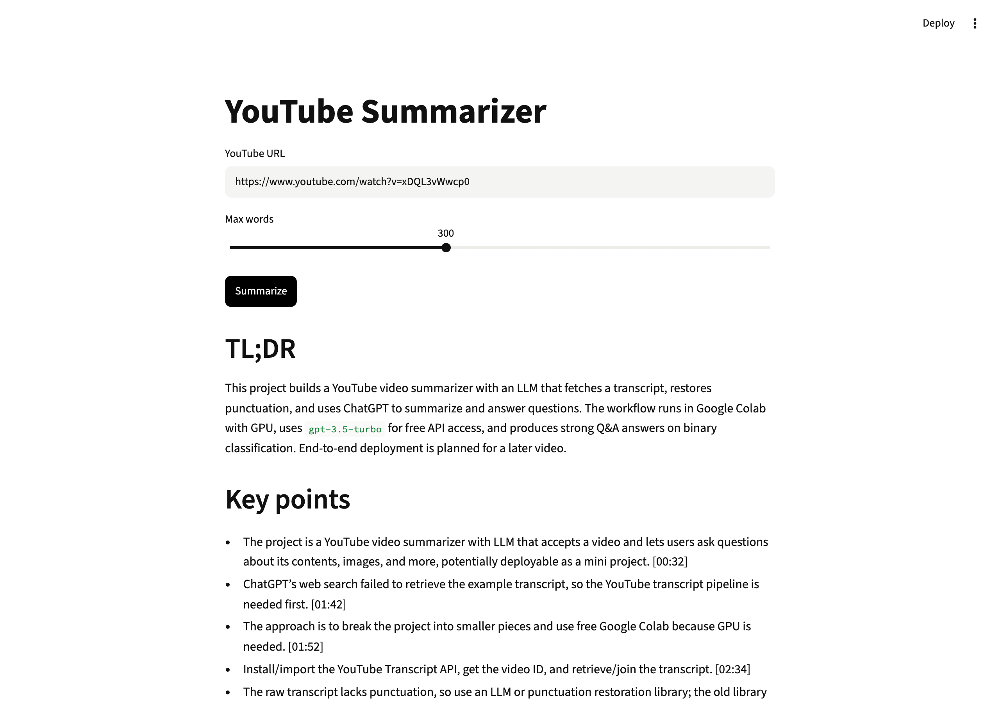

# YouTube Video Summarizer

Paste a YouTube link, get a TL;DR, key points and chapters. Every point links to the timestamp where it was said.



**Level:** Beginner · **Time:** ~2 hours · **Runs on:** laptop (Ollama) or any OpenAI-compatible API

Video: [Build a YouTube Video Summarizer with LLMs](https://www.youtube.com/watch?v=xDQL3vWwcp0)

## What you'll learn

- Fetching transcripts with `youtube-transcript-api`
- Chunking long text to fit a context window
- Map-reduce summarization
- Checking that cited timestamps really exist

## How it works

```
URL ─► timestamped transcript ─► ~6k-char chunks
    ─► LLM notes per chunk (map) ─► LLM merge into TL;DR / Key points / Chapters (reduce)
```

## Milestones

- [ ] **1. Transcript** – parse any YouTube URL, fetch the transcript (`transcript.py`)
- [ ] **2. Chunking** – split without losing timestamps (`transcript.py`)
- [ ] **3. Map-reduce** – summarize chunks, then merge (`summarize.py`)
- [ ] **4. UI** – Streamlit with a word-budget slider (`app.py`)
- [ ] **5. Eval** – score 85+ (`eval/run_eval.py`)

## Run it

```bash
pip install -r requirements.txt
cp .env.example .env && export $(xargs < .env)

PYTHONPATH=src python -m yt_summarizer "https://www.youtube.com/watch?v=xDQL3vWwcp0"
streamlit run app.py
```

Example output: [`demo/summary-xDQL3vWwcp0.md`](demo/summary-xDQL3vWwcp0.md)

## Score it

```bash
PYTHONPATH=src python eval/run_eval.py
pytest -q tests
```

3 original transcripts with known facts.

| Part | Weight | Checks |
|---|---|---|
| Facts | 50% | the summary mentions the facts that matter |
| Timestamps | 30% | every `[mm:ss]` cited exists in the transcript |
| Length | 10% | under the word budget |
| Structure | 10% | TL;DR, Key points and Chapters sections |

## Leaderboard

| Builder | Model | Score |
|---|---|---|
| reference | deepseek-flash | 100.0 |

## Stretch goals

- Ask follow-up questions about the video
- Transcribe videos without captions using Whisper
- Make timestamps clickable links
